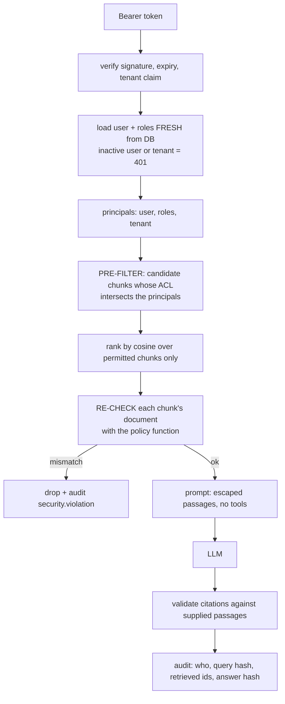

# permrag: permission-aware, multi-tenant RAG

A RAG service where **a user can only ever be answered from documents they are allowed to read**, enforced before retrieval ranks anything, checked again before anything reaches the prompt, and recorded in a tamper-evident audit log.

This is the problem every company hits the moment RAG touches internal data: the vector index does not know about permissions, so a naive "retrieve top-k, then ask the LLM" leaks the CFO's salary memo to an intern who asked about holidays.



## What is guaranteed, and how it is tested

| Guarantee | Mechanism | Test |
|---|---|---|
| No cross-tenant reads, ever | every query is tenant-scoped in SQL; ACLs reference same-tenant roles/users only | cross-tenant tests; 40 randomised worlds |
| Retrieval returns **exactly** the documents the caller may read (no leak, no over-filtering) | ACL is applied as a *pre-filter*; compared against an independent oracle | `test_fuzz_isolation.py`: 40 random worlds × every user, plus 10 mutation sequences |
| Unauthorized text never appears in a prompt | only filtered chunks are rendered; checked per user in the fuzz test | `test_generation_prompt_contains_only_permitted_text`, fuzz |
| Permission changes apply immediately | roles are read from the DB on every request, never from the token; ACL rewrite is transactional | role removal, ACL edit, visibility change, delete, deactivate tests |
| A bug in the pre-filter is still caught | post-retrieval re-check with the policy function; violation is dropped and audited | `test_defence_in_depth_drops_a_chunk_even_if_the_index_leaks` |
| Pre-filtering, not post-filtering | otherwise result counts leak and results shrink | `test_prefilter_returns_full_k_when_permitted_documents_exist` |
| Audit log cannot be silently edited | per-tenant HMAC chain, key kept outside the database | edit, delete, forged rewrite, per-tenant isolation, concurrent writers |
| Forged / expired / `alg=none` tokens rejected; tenant claim must match the user's real tenant | PyJWT with an explicit algorithm list; DB cross-check | `test_audit_api.py` |
| Prompt text cannot break out of its tag | passage text is HTML-escaped | `test_passage_text_cannot_break_out_of_its_tag` |

**93 automated tests**, all passing. The central property test is a fuzz test: it builds random tenants, roles, users, documents and ACLs through the real code paths, computes the allowed set in plain Python from the generated description, and requires retrieval to match it exactly.

## Authorization model

- **Tenants** are hard isolation boundaries. Created by the platform operator (`permrag create-tenant`), not over HTTP.
- **Roles** are per tenant. Users have zero or more roles. The configurable `admin` role manages the tenant.
- A **document** has a visibility: `tenant` (everyone in the tenant) or `restricted` (the owner, plus any listed roles and users).
- **Admins manage; they do not automatically read.** An admin sees document *metadata* (`GET /v1/admin/documents`) but retrieval content only if the ACL grants it. Least privilege is the default; grant yourself a role if you need access.
- The ACL lives in `document_acl` (authoritative) and is denormalised into `chunk_acl` for fast pre-filtering, rewritten in the same transaction as every change.

## Quickstart

```bash
pip install -e ".[dev]"
export PR_JWT_KEY=$(python -c "import secrets; print(secrets.token_urlsafe(48))")
export PR_AUDIT_HMAC_KEY=$(python -c "import secrets; print(secrets.token_urlsafe(32))")

permrag create-tenant acme --admin-email admin@acme.test     # prints tenant_id and admin_user_id
ADMIN=$(permrag token <admin_user_id>)
permrag serve &                                              # http://127.0.0.1:8000
H="authorization: Bearer $ADMIN"; J="content-type: application/json"

# a role, a user in that role, and a restricted document
curl -s -X POST localhost:8000/v1/admin/roles -H "$H" -H "$J" -d '{"name": "finance"}'
curl -s -X POST localhost:8000/v1/admin/users -H "$H" -H "$J" -d '{"email": "fin@acme.test", "roles": ["finance"]}'
curl -s -X PUT  localhost:8000/v1/documents/payroll -H "$H" -H "$J" \
     -d '{"title": "Payroll", "text": "Salary bands for 2026 ...", "allowed_roles": ["finance"]}'
curl -s -X PUT  localhost:8000/v1/documents/handbook -H "$H" -H "$J" \
     -d '{"title": "Handbook", "text": "Holiday policy ...", "visibility": "tenant"}'

# an ordinary user only ever sees the handbook; a finance user also sees payroll
USER=$(permrag token <user_id>)
curl -s localhost:8000/v1/search -H "authorization: Bearer $USER" -H "$J" -d '{"query": "salary bands"}'
```

`/v1/search` returns permitted chunks without calling an LLM. `/v1/query` adds generation and needs an LLM configured:

```bash
export PR_LLM_PROVIDER=anthropic            # or openai_compat (OpenAI, Ollama, vLLM, ...)
export PR_LLM_MODEL_ID=<model id>
export PR_LLM_API_KEY_ENV=ANTHROPIC_API_KEY # name of the variable holding the key
# for a local server: PR_LLM_PROVIDER=openai_compat PR_LLM_BASE_URL=http://localhost:11434/v1
```

## API

| Method | Route | Who | Purpose |
|---|---|---|---|
| POST | `/v1/search` | any user | permitted chunks for a query (audited) |
| POST | `/v1/query` | any user | grounded answer with validated citations (audited) |
| GET | `/v1/documents` | any user | documents the caller may read |
| PUT / DELETE | `/v1/documents/{id}` | admin | idempotent upsert (content, visibility, ACL) / delete |
| GET | `/v1/admin/documents` | admin | metadata and ACLs, no content |
| POST | `/v1/admin/roles`, `/v1/admin/users` | admin | create roles / users |
| PUT / DELETE | `/v1/admin/users/{id}/roles`, `/v1/admin/users/{id}` | admin | set roles / deactivate |
| GET | `/v1/audit`, `/v1/audit/verify` | admin | read the tenant's audit log / verify the chain |
| GET | `/healthz` | none | liveness |

Errors: 401 unknown/invalid identity, 403 not an admin, 404/409/422 as appropriate, 429 rate limit, 502/503 for generation failures. Rejected identities (unknown or inactive user, tenant mismatch) and forbidden admin calls are audited.

## Configuration

Environment variables (prefix `PR_`, see `.env.example`); changing them needs a restart. Secrets are never stored in the database.

| Variable | Purpose |
|---|---|
| `PR_JWT_KEY`, `PR_JWT_ALGORITHM`, `PR_JWT_ISSUER` | token verification (HS256 secret ≥ 32 bytes, or a PEM public key for RS256/ES256) |
| `PR_AUDIT_HMAC_KEY` | audit chain key (≥ 16 bytes), required |
| `PR_ADMIN_ROLE_NAME` | name of the tenant-admin role (default `admin`) |
| `PR_DB_PATH`, `PR_EMBEDDING_MODEL` | storage and embedding model |
| `PR_DEFAULT_TOP_K`, `PR_MAX_TOP_K`, `PR_CHUNK_CHARS`, `PR_CHUNK_OVERLAP_CHARS`, `PR_MAX_CONTEXT_CHARS`, `PR_MAX_DOCUMENT_CHARS` | retrieval and limits |
| `PR_RATE_LIMIT_PER_MINUTE` | per-user request limit (default 60, `0` disables); in-process |
| `PR_AUDIT_LOG_QUERY_TEXT` | store raw query text in the audit log (default `false`: only a SHA-256) |
| `PR_LLM_*` | generation provider, model, base URL, key variable name, limits |

## Design decisions

- **Pre-filter, then re-check.** Defence in depth: the pre-filter is for correctness and speed, the re-check is for the day someone breaks it.
- **No answer cache.** A shared semantic cache across users is itself a leak path (user B gets user A's answer). This service deliberately has none.
- **Roles from the database, not the token.** Tokens prove identity; a stolen or stale token cannot keep a role the user lost.
- **No tools for the model.** A prompt-injected passage can mislead an answer but cannot call anything or read anything else; the model only ever saw permitted text.
- **Hash-chained audit with an external key.** Someone with write access to the database but not the key cannot rewrite history without detection.

Full specification, threat model, failure matrix and ADRs: [`docs/SPEC.md`](docs/SPEC.md).

## Limitations (read before deploying)

- **Tokens:** `permrag token` is a development issuer (HS256 only). Production should use your identity provider; asymmetric verification can be configured with a PEM public key but is **not covered by tests**, and JWKS fetching/rotation is **not** implemented.
- **Granularity:** access is per document (chunks inherit it). No per-section ACLs, no groups or nested roles, no deny rules.
- **Prompt injection is mitigated, not solved.** The architecture bounds the damage (permitted text only, no tools, citation validation) but a malicious document can still influence an answer given to someone allowed to read it.
- **Audit completeness:** the HMAC chain detects edits, deletions and reordering; it cannot detect truncation of the *most recent* rows by someone who can also delete from the tail. Export the head MAC to external storage for that.
- **Scale:** SQLite and exact in-memory search per tenant; a tenant with millions of chunks needs a vector database with payload filtering. The `TenantIndex` class is the seam. Rate limiting is in-process.
- **Generation was run live only once, on a small local model.** A smoke test against Ollama (`llama3.2:3b`) showed the finance user answered correctly with a citation while an engineer asking the same question received **no salary information** (the model's format slip then produced a 502, which led to lenient abstention handling and a minimum-content check). The Anthropic client has only been tested against a local server imitating its wire format. `/v1/search` needs no LLM.
- **Security review:** this has not had an independent security review. Treat it as a reference implementation and test your own deployment.

## Development

```bash
pip install -e ".[dev]"
pytest -q                       # 93 tests (the fuzz suite takes ~10 s)
ruff check src tests && ruff format --check src tests
mypy src
permrag verify-audit            # verify the HMAC chain of every tenant
```

A `Dockerfile` is included (single container, non-root). It was not built or run in the environment this project was developed in.

## License

MIT
