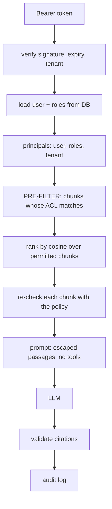

# permrag: permission-aware, multi-tenant RAG

A RAG service where a user only gets answers from documents they are allowed to read.

## What I did
- Built tenants, roles, users and per-document access lists (ACLs). A document is visible to the whole tenant or restricted to chosen roles and users.
- Applied the ACL **before** ranking, so only permitted chunks are searched, then checked every chunk again with the policy function before it goes into the prompt.
- Loaded roles from the database on every request instead of trusting the token, so permission changes apply immediately.
- Built an audit log (who asked, hash of the query, which chunks were retrieved, hash of the answer) chained with HMAC so edits or deletions are detected.
- Added grounded answers with checked citations, JWT login, rate limiting and admin routes for roles, users and documents.

## Results
- A fuzz test builds random tenants, roles, users, documents and ACLs, then checks that retrieval returns exactly the documents the user may read. It passes on 40 random worlds for every user, plus 10 sequences of permission changes.
- 93 automated tests pass, covering cross-tenant reads, forged and expired tokens, role removal, ACL edits, deactivated users, audit-log tampering and prompt text breaking out of its tag.
- In a live check with a small local model (Ollama `llama3.2:3b`), the finance user got the right answer with a citation and an engineer asking the same question got no salary information.

## How it was built

## Tech stack
Python, FastAPI, Pydantic, SQLite, PyJWT, fastembed embeddings, HMAC, pytest, Docker. LLM through Anthropic or any OpenAI-compatible server.
